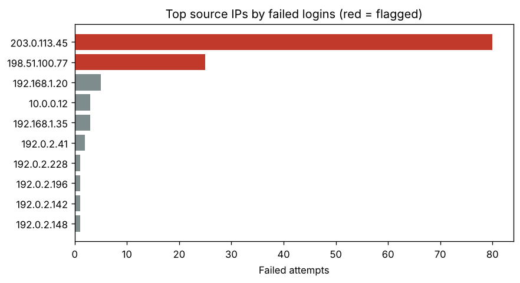
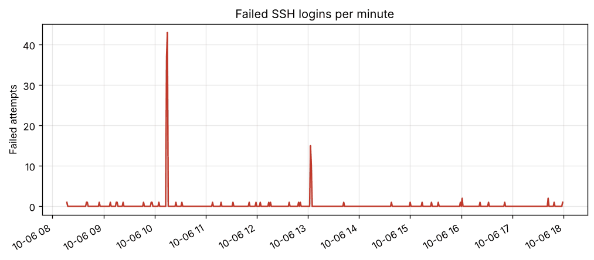

# SSH Log Attack Detector

A Python tool that reads Linux SSH authentication logs, finds brute-force login attempts, and flags cases where an attacking IP later logged in successfully.



## Why I built this

Servers connected to the internet get hit with automated password-guessing attacks constantly. Security analysts read through `auth.log` files to spot these attacks, which is slow to do by hand. I wanted to automate the first pass: separate real attacks from normal typos, and surface the dangerous case where an attacker actually got in.

## What it detects

| Alert | How it's detected |
|---|---|
| Brute-force attack | An IP fails to log in N or more times within a sliding time window (default: 5 failures in 60 seconds) |
| Possible compromise | A flagged IP later has a successful login |
| Targeted accounts | Usernames attackers tried most often |

The sliding-window check matters because a user who mistypes their password once a day should not be flagged, but a script trying 80 passwords in two minutes should.

## Example output

```
==================================================
SSH LOG ANALYSIS REPORT
==================================================
Login events parsed : 207
Failed logins       : 146
Successful logins   : 61
Unique source IPs   : 34

Brute-force IPs flagged: 2
  203.0.113.45     45 failures in one window
  198.51.100.77    17 failures in one window

!! POSSIBLE COMPROMISE: flagged IP later logged in successfully
  198.51.100.77    accepted as: deploy
```



## How to run

```bash
pip install -r requirements.txt

# Analyze the included sample log
python detector.py sample_logs/auth.log

# Stricter settings and save charts
python detector.py sample_logs/auth.log --threshold 10 --window 30 --charts

# Run the tests
python -m pytest tests
```

On a real Linux server you can point it at `/var/log/auth.log` (needs read permission).

## How it works

1. **Parsing:** a regular expression pulls the timestamp, result (Failed/Accepted), username, and source IP out of each `sshd` line. Lines that aren't login attempts are skipped.
2. **Brute-force detection:** failures are grouped by IP and sorted by time. Two pointers move through the list so the window never spans more than the set number of seconds; the largest count seen in any window is that IP's score.
3. **Compromise check:** for each flagged IP, any successful login after its first failure is reported.
4. **Charts:** Matplotlib plots failures per minute and the top source IPs.

## Sample data

`sample_logs/auth.log` is generated by `generate_sample_log.py`. It mixes normal logins, a fast dictionary attack, a slower attack that succeeds, and random background noise. All IP addresses come from reserved documentation ranges (RFC 5737) or private networks.

## What I'd add next

- GeoIP lookup to show where attacking IPs are located
- Export a blocklist in a format `iptables` or `fail2ban` can use
- Support for other log formats (Windows Event Logs, web server logs)

## Skills used

Python, regular expressions, log analysis, sliding-window algorithms, Matplotlib, pytest
